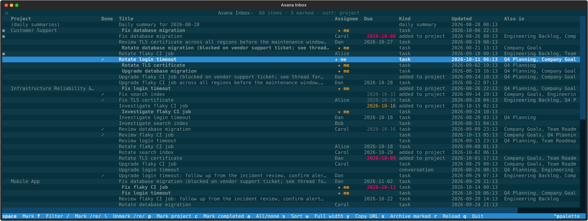
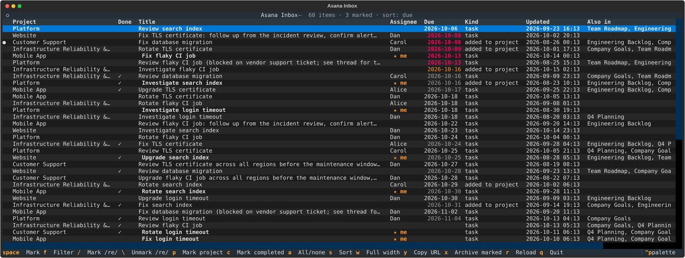
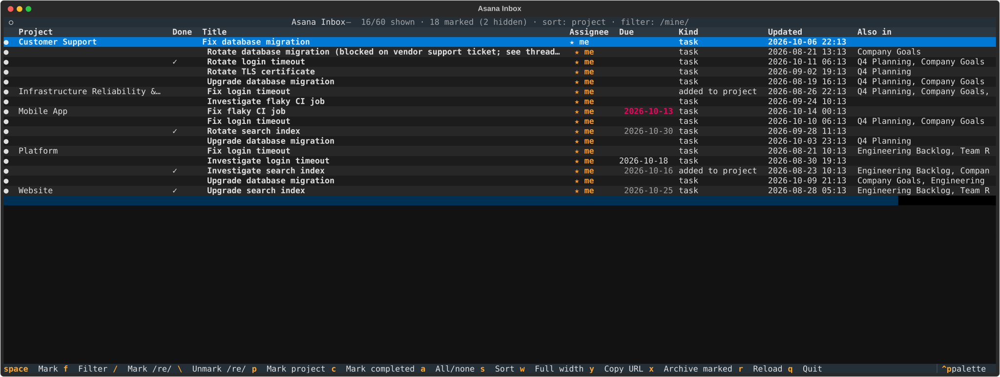
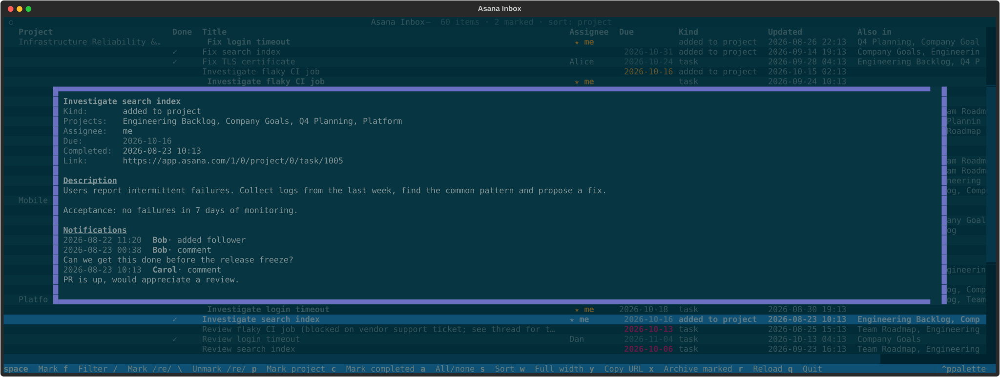
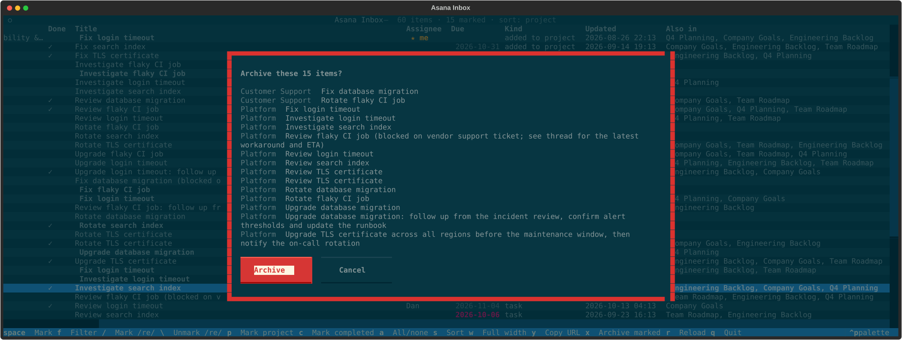

# asana-inbox

A terminal UI for bulk-archiving your Asana Inbox. You can group items by project, filter them, mark them by regex, and archive many at once.

Asana's public API has no Inbox endpoint, so this tool talks to the web app's private sync protocol using your browser's login cookies. That protocol is undocumented and may break when Asana ships a release (see `PROTOCOL.md`).



## Screenshots

All screenshots use the built-in fake data (`./asana_inbox.py --fake`).

| | |
| --- | --- |
| **Sorted by due date**: overdue in red, due today in yellow | **Filtered** with `f mine`, then all shown rows marked with `a` |
|  |  |
| **Details** (`Enter`): description, projects and notifications | **Archive confirmation** (`x`) listing what will be archived |
|  |  |

Regenerate them with `./docs/screenshots.py`.

## Requirements

- [uv](https://docs.astral.sh/uv/). It installs Python and the dependencies on first run.
- A browser logged in to app.asana.com: Firefox, Chrome, Chromium, Brave or Edge, or a cookie file (see below).

## Setup

You need two IDs. Both are fixed per user, so find them once.

1. **Domain user ID** (`ASANA_DU`). Open your Inbox in the web app. The URL looks like
   `https://app.asana.com/1/<workspace>/inbox/<domain user id>/…`; use the number after `/inbox/`.
   This is *not* the same as your user ID.
2. **Inbox view ID** (`ASANA_VIEW`). The inbox doesn't load without it.
   1. In the browser, open DevTools → Network → **WS**, then reload the Inbox page.
   2. Click the `cdn.sync.app.asana.com/socket…` connection and filter its messages for `CurrentDomainUserProjectionInbox`.
   3. Select the outgoing (↑) message with `"msg":"sub"` and `"name":"CurrentDomainUserProjectionInbox"`.
      The ID is at `params.inboxThreadsInfo.multifilterParams.objectViewId`:

      ```json
      {"msg": "sub", "name": "CurrentDomainUserProjectionInbox",
       "params": {"db_object_id": "<domain user id>", …,
                  "inboxThreadsInfo": {…,
                                       "multifilterParams": {"objectViewId": 1234567890123456, …}}}}
      ```

      If you don't see the message, keep the WS tab open and reload the Inbox page; the app sends it when the page loads.
      As a cross-check, the message's `params.db_object_id` (and `currentDomainUserId`) is your domain user ID.

Put both in your shell config:

```sh
export ASANA_DU=<domain user id>
export ASANA_VIEW=<objectViewId>
```

## Running

```sh
./asana_inbox.py            # or: uv run asana_inbox.py
./asana_inbox.py --fake     # try the UI on generated data, no Asana needed
```

The first start downloads Asana's web app bundle once per Asana release (about 46 MB, cached in `~/.cache/asana-inbox`). The whole inbox then loads in batches; the progress shows in the header.

### Cookies

By default the tool uses the first browser that has an Asana login, checking Firefox, Chrome, Chromium, Brave, then Edge.

```sh
./asana_inbox.py --browser chrome --profile "Profile 1"   # pick a browser / profile
./asana_web.py cookies                                    # show which source is used (names only)
```

Chromium-based browsers encrypt cookies with your desktop keyring, so you may be asked to unlock it.

You can also use a cookie file with `--cookies FILE` or `ASANA_COOKIES=FILE`. Either format works:

- **Copy as cURL:** in DevTools → Network, right-click any app.asana.com request → *Copy as cURL*, and paste it into the file. Only the `Cookie:` part is used.
- **Netscape `cookies.txt`:** e.g. `yt-dlp --cookies-from-browser firefox --cookies cookies.txt`, or a "cookies.txt" browser extension.

The file is a live login: run `chmod 600` on it and keep it out of git (`cookies*.txt` is already ignored). If Asana rejects it, set `ASANA_UA` to the User-Agent of the browser it came from.

### Other options

| Option / env | Purpose |
| --- | --- |
| `--ignore-project NAME` / `ASANA_IGNORE_PROJECTS=a,b` | Don't group by broad projects like "Company Goals" when a task has more specific ones. |
| `-n N` | Load only the newest N threads (default: all). |
| `ASANA_FF_CONTAINER=N` | Use a Firefox Multi-Account Container's cookies. |

## Using it

Each row is one task (or conversation, daily summary, …) with unread notifications. Archiving a row marks those notifications read, the same as archiving in the web app. Project threads ("tasks added to X") are split into one row per task, so you can archive them individually.

| Key | Action |
| --- | --- |
| `↑`/`↓`, `PgUp`/`PgDn` | Move |
| `Enter` | Details: description, comments and other notifications, link |
| `space` | Mark / unmark row |
| `p` | Mark / unmark all shown rows in this row's project |
| `c` | Mark / unmark all shown completed tasks |
| `a` | Mark / unmark all shown rows |
| `/` and `\` | Mark / unmark shown rows matching a regex |
| `f` | Filter by regex (`Esc` or an empty filter clears it) |
| `s` | Cycle sort: project → title → newest → oldest → due |
| `w` | Toggle shortening long titles (72 chars) and the Project column (30 chars) |
| `y` | Copy the row's Asana link to the clipboard (OSC 52; in tmux, set `set-clipboard on`) |
| `x` | Archive marked rows (asks for confirmation) |
| `r` | Reload from Asana |
| `q` | Quit |

The regex for `f`, `/` and `\` matches the project, title, other projects, kind and assignee, plus the words `done` (completed tasks) and `mine` (assigned to you). For example, `f mine` shows only your tasks, and `/Support Triage` marks every row in that project.

Bulk marking only affects rows the current filter shows. Marks survive filter changes, and the archive confirmation says how many marked rows are hidden.

In the table:

- **★ me** and a bold title: tasks assigned to you.
- **✓** in the Done column: completed tasks.
- **Due** column: overdue dates in red, today's in yellow.

After archiving, rows disappear immediately; press `r` to re-sync with Asana.

To change the color theme, open the command palette with `ctrl+p` and choose *Change theme*. The theme and the `w` setting are saved in `~/.config/asana-inbox/settings.json` (or under `$XDG_CONFIG_HOME`).

## Command-line client

`asana_web.py` exposes the same protocol without the UI. It's handy for debugging:

```sh
./asana_web.py inbox                       # list items with ids and projects
./asana_web.py archive <id> [--yes]        # dry run unless --yes
./asana_web.py inbox --dump frames.jsonl   # save raw protocol traffic
```

Dumps contain your inbox content and are ignored by git (`*.jsonl`).
